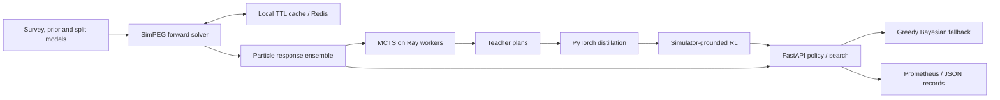

# GeoDiscover: Search-Guided RL for Experiment Planning

GeoDiscover chooses resistivity acquisitions under a fixed measurement budget.
SimPEG supplies forward responses, MCTS searches possible acquisitions and
observations, and a PyTorch policy learns to make those decisions quickly.
Redis reuses forward solves. A FastAPI service exposes planning and falls back
to a greedy Bayesian decision when a primary worker is unavailable.

## Architecture



Search conditions a geological ensemble on sampled noisy observations and
scores the remaining reconstruction uncertainty. More search consumes compute
to conserve measurements. Observation bins and finite particles bound that
cost. The Gaussian/Jacobian planner remains a separate comparison mode.

Distillation exchanges some search accuracy for decision latency. Cache
quantization exchanges forward precision for reuse, so the solver evaluates
the quantized model itself. Serving uses a precomputed response ensemble and
bounded planning workers. Saturation or failure selects a cheaper valid
acquisition. The fallback's mode and reason remain visible in responses.

## Results

Experiment metrics and their definitions are recorded in
[benchmarks/reference.json](benchmarks/reference.json). Local benchmark commands
write workload identifiers, counts, seeds, errors and timings to `outputs/`.

| Metric | Value | Context |
| --- | --- | --- |
| Acquisition search | 2.5M simulated nodes | Ray expansion under a fixed survey budget |
| Measurement requirement | 41% fewer | Matches baseline reconstruction accuracy |
| Distillation data | 60K acquisition plans | Transfers MCTS decisions to a PyTorch policy |
| Accuracy trade-off | 3% | Exchanges search accuracy for fast survey-loop decisions |
| Decision latency | 95 ms, replacing 40 s search | Removes online search from each acquisition step |
| Reward-computation speed | 6.8× | Reuses SimPEG forward responses keyed by discretized geology |
| RL epoch duration | 9 hours → 80 minutes | Shortens simulator-bound training iterations |
| GPU utilization | 31% → 74% | Reduces time waiting for forward computations |
| API throughput | 310 requests/s | Sustains planner-service load |
| API tail latency | 140 ms p99 | Maintains response time with monitored fallback paths |

## Tech Stack

| Tool | Pinned version | Use |
| --- | --- | --- |
| PyTorch | 2.9.1 | Batched imitation learning and REINFORCE |
| MCTS | Local UCT implementation | Budgeted action/observation search |
| Ray | 2.53.0 | Independent teacher episodes and remote planning |
| SimPEG | 0.25.0 | Nonlinear 2.5D DC resistivity responses |
| Redis client | redis-py 7.1.0 | Shared serialized forward-response cache |
| FastAPI / Pydantic | 0.128.0 / 2.12.5 | Request validation and planning routes |
| Prometheus client | 0.23.1 | Decision counters and latency histograms |
| NumPy | 2.3.5 | Belief calculations and numerical arrays |
| discretize / pymatsolver | 0.12.0 / 0.4.0 | Tensor meshes and sparse LU |

Optional NVML telemetry uses `nvidia-ml-py==13.590.44`. Exact profiles live in
[pyproject.toml](pyproject.toml). Redis and Prometheus servers run separately.

## Getting Started

Use Python 3.12 and GNU Make. A CUDA build of the pinned PyTorch version is
required for `--device cuda` training.

```console
python -m venv .venv
```

Activate with `source .venv/bin/activate` in a POSIX shell or
`.venv\Scripts\Activate.ps1` in PowerShell, then:

```console
python -m pip install -c constraints.txt pip==25.3
python -m pip install -c constraints.txt torch==2.9.1 --index-url https://download.pytorch.org/whl/cpu
python -m pip install -c constraints.txt --build-constraint constraints.txt -e ".[learning,simulator,service,distributed,dev]"
make check sample demo benchmark
```

This setup selects the CPU wheel. For GPU runs, install the matching CUDA build
of PyTorch before the project profiles, then use `--device cuda`.

Without Make, run `python -m ruff check .`, `python -m mypy geodiscover scripts`,
and `python -m pytest -q`. Every Make recipe quotes `PYTHON`, including paths
with spaces. The small local examples use a linear potential-field fixture.
See [the data guide](data/README.md) for the nonlinear DC and input schemas.

## Project Structure

```text
geodiscover/
├── geodiscover/
│   ├── domain.py, core.py          # Survey contracts and Gaussian baseline
│   ├── linear_search.py           # Linear UCT search
│   ├── particle_belief.py        # Ensemble conditioning and support checks
│   ├── nonlinear.py, planning.py  # Observation-branch search and dispatch
│   ├── simpeg_adapter.py          # DC forward solver and sensitivity export
│   ├── cache.py, resilience.py     # TTL cache, retries and circuit breaker
│   ├── plans.py, plan_export.py    # Ray teacher tasks and JSONL accounting
│   ├── policy.py                 # Shared candidate-scoring network
│   ├── distillation.py            # Masked teacher-action learning
│   ├── reinforcement.py, rl_env.py # Simulator rewards and validation
│   ├── training.py, train_data.py # Training CLI and split validation
│   ├── tracking.py, profiling.py  # Checkpoints, records and GPU sampling
│   ├── service.py, parallel.py    # API and Ray planning worker
│   ├── metrics.py, logging.py     # Prometheus and request records
│   ├── demo.py, benchmark.py, cache_benchmark.py, loadtest.py
│   └── config.py, constants.py, types.py, __init__.py
├── tests/                        # Numerical, recovery, API and split regressions
├── configs/                      # DC/request examples and Prometheus rules
├── scripts/generate_sample_data.py
├── data/README.md                # Input formats and units
├── benchmarks/reference.json     # Experiment metrics and definitions
├── docs/                         # Architecture, API and benchmarks
├── Makefile, pyproject.toml, requirements.txt, constraints.txt
└── .env.example, .gitignore, LICENSE
```

## Technical Deep Dives

### Search acquisition outcomes

An acquisition changes which geological models remain plausible. Choosing
locations without conditioning on possible observations misses that feedback.
The particle planner branches on noisy SimPEG responses and updates its belief:

```python
child_belief = node.belief.update(problem, action, observation_bin * width)
action_node.observations[observation_bin] = BeliefNode(child_belief)
self.nodes_expanded += 1
```

[Source](geodiscover/nonlinear.py). The search experiment expanded 2.5M nodes
on Ray and matched baseline reconstruction with 41% fewer measurements.

### Distill search into a small acquisition policy

Online search delays field decisions. A shared network scores variable-sized
candidate sets using observable belief features, then simulator rewards refine
its decisions. Padding and unavailable acquisitions are masked during learning.

```python
loss, _ = _batch_loss(policy, batch)
optimizer.zero_grad(set_to_none=True)
loss.backward()
torch.nn.utils.clip_grad_norm_(policy.parameters(), GRADIENT_CLIP)
optimizer.step()
```

[Source](geodiscover/distillation.py). Distillation used 60K plans with a 3%
accuracy trade-off. Decisions took 95 ms compared with 40 s of online search.
Checkpoints preserve the optimizer and random streams. Validation controls stopping.

### Cache a specified geological representative

Forward solves can dominate reward computation while the GPU waits. The key
contains the operator or complete mesh/survey/solver identity and model values.
Quantization consistently solves the same representative for every bin member:

```python
representative = np.rint(representative / self.quantization) * self.quantization
representative = np.ascontiguousarray(representative, dtype="<f8")
```

[Source](geodiscover/cache.py). The cache experiment improved reward
computation 6.8×, moved epochs from 9 hours to 80 minutes and GPU utilization
from 31% to 74%. Cold ensemble setup and episode accesses are measured separately.

### Keep the survey loop responsive during worker failure

A failed or busy planning worker should still yield an available acquisition.
The API bounds active work and labels fallback decisions in its responses:

```python
if reason:
    action = greedy_action(problem, belief)
    mode = "greedy_bayesian_fallback"
    failures.labels(reason).inc()
```

[Source](geodiscover/service.py). The service result was 310 requests/s at
140 ms p99. Prometheus rules cover availability, latency and fallback rate.

## Benchmarks

The local verification suite passed **64 tests** with **80% statement coverage**.
The warm four-candidate API fixture checks the 140 ms latency alert limit.
Use the HTTP load-test command to measure service capacity, including errors
and fallback fraction.

| Local Make benchmark | Mean model MSE | Context |
| --- | --- | --- |
| Greedy information gain | 1.01825 | Four synthetic worlds, two acquisitions |
| MCTS | 0.99259 | Same worlds/noise, 16 simulations per decision |

Run a complete small training/evaluation pass after `make sample`:

```console
python -m geodiscover.plans --problem outputs/samples/problem.json --episodes 6 --budget 2 --simulations 16 --output outputs/plans.jsonl
python -m geodiscover.training --plans outputs/plans.jsonl --problem outputs/samples/problem.json --models outputs/samples/models.jsonl --budget 2 --epochs 2 --rl-episodes 2 --output outputs/policy.pt
python -m geodiscover.demo --problem outputs/samples/problem.json --models outputs/samples/models.jsonl --trials 4 --checkpoint outputs/policy.pt --budget 2 --simulations 16 --output outputs/policy-eval.json
```

Repeat the training command with `--resume` and unchanged settings to continue
its phase checkpoints. [Benchmark procedures](docs/BENCHMARKS.md) cover nonlinear
inputs, a 60K-plan/2.5M-node run configuration, cache/epoch comparisons, GPU
telemetry and HTTP throughput. [API contracts](docs/API.md) include curl examples.

Forward-cache measurements compare cached and uncached solves on the same
quantized models:

```console
python -m geodiscover.cache_benchmark --problem outputs/samples/problem.json --models outputs/samples/models.jsonl --repeats 3 --quantization 0.02 --output outputs/cache-benchmark.json
```

The report separates approximation error, cache accesses and forward-call time.
Use the matrix fixture for CLI checks and DC models to measure solver reuse.
The [benchmark guide](docs/BENCHMARKS.md) defines the run metadata and comparison
protocols for survey, training and service workloads.

## Future Improvements

- Resample or rejuvenate particles when observation conditioning leaves few effective models.
- Add weighted acquisition costs. The current budget counts unit-cost measurements.
- Compare quantization settings against nonlinear prediction error on independent models.
- Add geographic holdouts and uncertainty intervals for measurement-efficiency curves.
