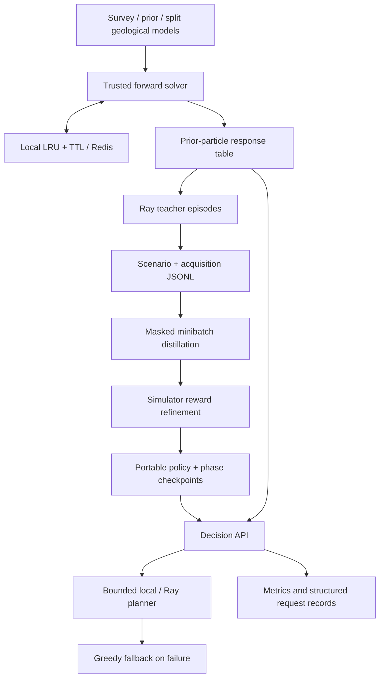

# Acquisition planning architecture

## Survey and observation model

`domain.Problem` validates a candidate response operator, observation noise,
prior mean and positive-definite covariance. An acquisition index identifies
one candidate measurement. Budgets currently count distinct acquisitions at
unit cost. The linear mode uses `y = A m + offset + noise` with exact sequential
Gaussian updates.

The DC adapter uses a tensor mesh, dipole current sources and dipole voltage
receivers. Its model is natural-log conductivity per mesh cell. `ExpMap` maps
that vector to conductivity, and `Simulation2DCellCentered` predicts nonlinear
2.5D voltage responses. The finite-difference export provides a local operator
and offset for the Gaussian baseline. Actual particle search retains nonlinear
forward responses instead of replacing them with this operator.

## Data flow

## Beliefs and search

`ParticleBelief` stores geological particles, their noiseless candidate
responses and normalized weights. A sampled observation updates weights with
the configured Gaussian noise likelihood. Search branches over acquisitions
and discretized observation bins. Random completion rollouts estimate the
remaining budget's reduction in posterior model variance.

The particle ensemble is sampled independently of the environment's true
model. Truth supplies environment observations and training rewards. Policy
features and action selection use the resulting beliefs and measurements.
Each update reweights the initial particle ensemble within its prior support.
Set bin width and particle count for the intended noise/prior model and monitor
the effective sample size exposed by search statistics. A zero-weight particle
stays outside the prior's support after an update. Wrong-survey ensemble
dimensions fail before planning.

`linear_search.MCTS` is the Gaussian comparison path. Its future covariance
depends on selected locations rather than observed values. The two backends
share dispatch and acquisition-policy interfaces, while retaining different
belief updates and search objectives.

## Distributed teacher collection

`plans.iter_episodes` submits independent episodes through Ray, with a bounded
number of pending object references. Each worker constructs its simulator and
cache, samples a true model, and collects search-selected actions. A new belief
conditions on each actual observation before the next decision.

`--target-plans` counts teacher action-state records. `--max-nodes` caps actual
tree expansions across workers. The controller partitions an allowance across
episodes and each episode reserves an expansion for every remaining decision.
The exporter reports expanded nodes separately from search simulations and
physical solve misses. A fixed allowance can remain partly unused.

Version 2 JSONL writes one scenario/ensemble header followed by its plan records.
The writer streams episode results through the driver. Training/validation
assignment is scenario-level.
Geographic grouping is supplied by the experiment's input preparation. Scenario
inputs cannot change between decisions, and plan records cannot replace header
context. The same validation applies to in-memory distillation inputs.

## Learned decisions and training state

The shared MLP consumes six features per candidate: normalized predictive mean,
log predictive signal-to-noise ratio, an information proxy, selection status,
operator-row magnitude and remaining-budget fraction. Candidate counts may
vary across surveys. Padded and previously acquired positions are masked.

Distillation minimizes teacher-action cross-entropy. REINFORCE then uses
undiscounted reconstruction-MSE improvements, an EMA baseline, an entropy term
and gradient clipping. The greedy fallback uses predictive information gain.
For particle beliefs the fallback scores the remaining candidates by predictive
variance.

Phase checkpoints store last optimizer weights, optimizer state, NumPy/CPU/CUDA
random streams, completed-step cursor, history, validation state and separate
best weights. Checkpoint writes are flushed and atomically replaced. Resume
checks data/feature fingerprints and optimization settings. Distillation
returns its best validation weights. RL validation follows a fixed cadence.
Final export validation is recorded separately from the durable patience state.

RL checkpoints also bind the incoming distilled weights. Changing distillation
while reusing an earlier refinement checkpoint would otherwise silently discard
the new policy. Start a new refinement run after changing that policy. Explicit
model inputs reject identical geological vectors across splits, even under new
IDs. Exports record training-world hashes for checks against separately supplied
evaluation files. Use current policy exports to retain these fingerprints, and
combine exact-world checks with geographic or stratigraphic holdouts.

JSONL experiment records include run ID, phase, step, timestamp and measured
metrics. Epoch profiles separate wall/CPU time, CUDA peak allocation and
available device-wide NVML utilization. Ensemble setup is recorded separately
from the RL episode cache counters.

## Cache identity, expiration and outages

Linear keys include the full operator and offset. DC keys include mesh widths,
origin, candidate electrode geometry/current, mapping, solver settings and
SimPEG version. Model dimensions, values and quantization resolution complete
the key. Noisy observations are sampled after a noiseless cache lookup.

The local cache bounds entries, copies returned arrays and expires entries by
TTL. Redis writes use server-side expiration. `invalidate(model)` removes that
model's local and backend entry. A changed physics identity creates a different
namespace. Explicit quantization computes the representative model before
solving, so cache bins have a defined approximation.

`cache_benchmark` bypasses both cache tiers for its control pass and then replays
the same model representatives through the cache. Separate untimed diagnostics
compare quantized predictions against exact models. Response hashes must match
between conditions. The fixed pass order and any reuse inside the numerical
solver belong in the comparison record. This report covers forward-call timing.
Use training profiles for RL epoch wall time and device utilization.

Transient backend failures receive bounded exponential retries. Repeated
failures open a circuit and bypass Redis until the recovery interval ends.
The forward solver remains available locally. Failed reads/writes increment
backend-failure counters. A failed backend invalidation is recorded and its
server entry remains bounded by TTL.

## Decision serving

Inline request matrices use Gaussian beliefs. A configured DC survey loads its
particle response table during service setup. Each request conditions that
prior on the supplied acquisition history. Policy inference and local/remote
search use the same observable belief features.

The worker pool has a bounded number of occupied slots. Saturation immediately
selects a fallback. Search observes a deadline. Remote Ray tasks are cancelled
when retrieval fails. A custom hung Python thread retains its slot because
threads cannot be forcibly terminated safely. This prevents abandoned work
from growing an unbounded queue.

The response includes the selected action, decision mode, fallback reason and
expected information proxy. Malformed primary outputs are rejected before
indexing arrays. Request IDs are returned in headers and included in JSON
request records. Metrics report mode counts, fallback reasons and latency.

## Operating trade-offs

- More simulator/search work can reduce the number of physical measurements.
- Distillation reduces decision time while accepting a measured accuracy trade-off.
- Geology quantization improves reuse while introducing forward-model approximation.
- Precomputed ensembles move solver cost to setup. They need rebuilding when the prior or survey changes.
- Bounded workers preserve latency/fallback behavior while limiting simultaneous expensive searches.

Authentication and TLS belong at the deployment boundary. Prometheus is
configured to scrape a service on the same host. Adjust its target for the
actual deployment. Manage the service and Redis through the deployment host's
process manager. The [API guide](API.md) and [benchmark procedures](BENCHMARKS.md)
describe the executable interfaces.
